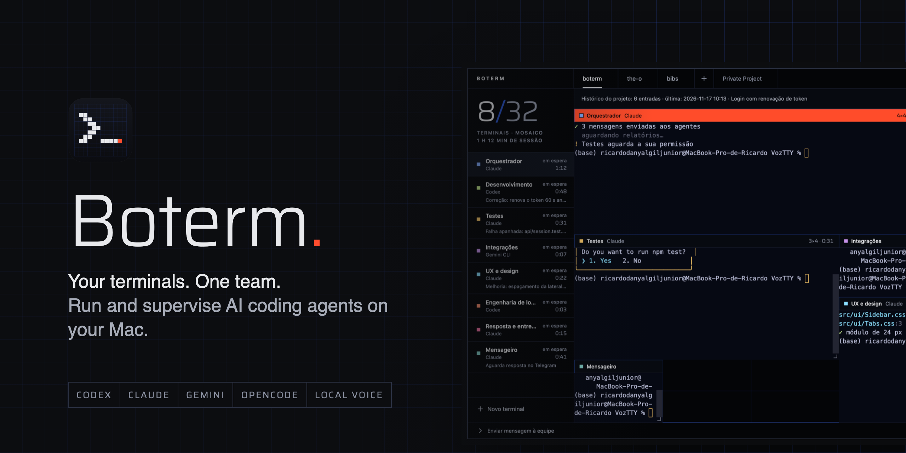
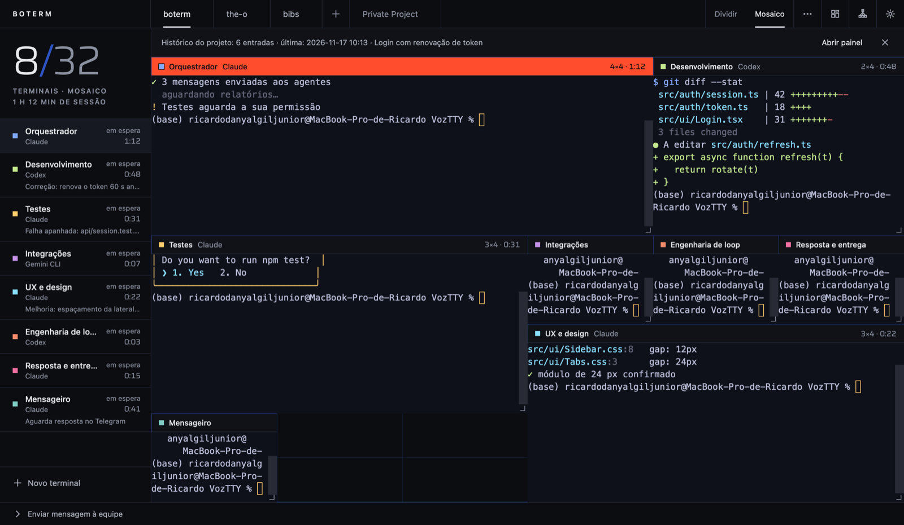
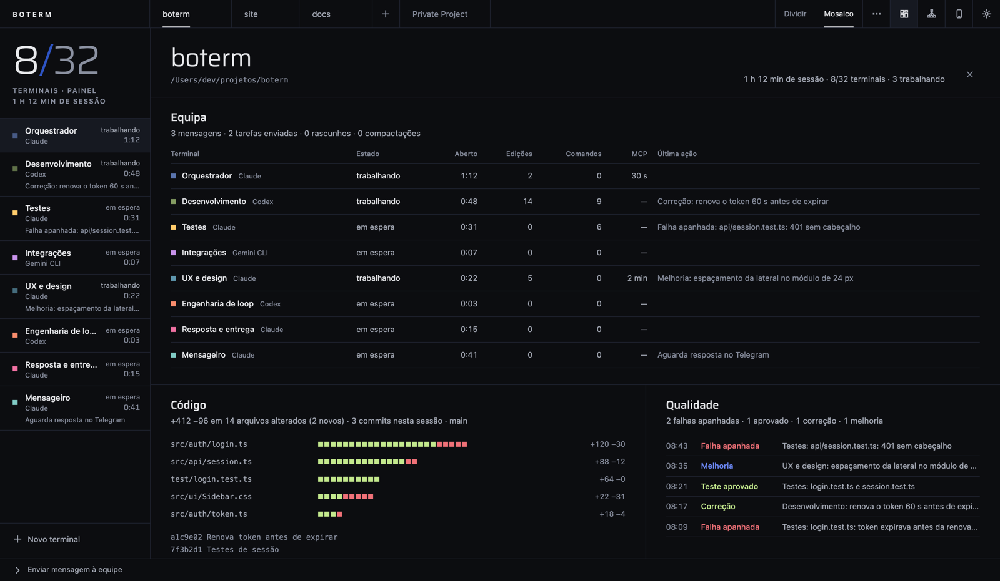
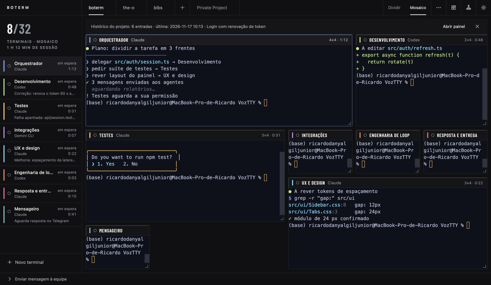
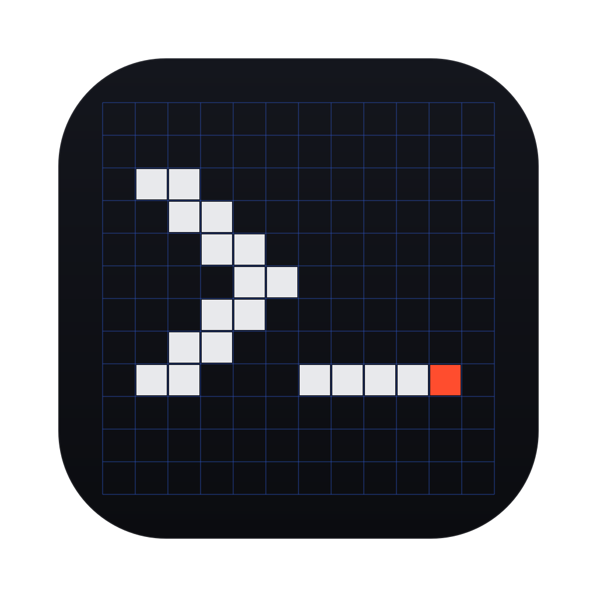

<p align="center">
  
</p>

<p align="center">
  <a href="https://github.com/ricdanyalgil/Boterm/releases/tag/v0.4.1"></a>
  
  
  <a href="LICENSE"></a>
  <a href="CONTRIBUTING.md"></a>
</p>

<p align="center">
  <a href="#download">Download</a> ·
  <a href="#what-it-does">Features</a> ·
  <a href="#the-development-team">The team</a> ·
  <a href="#agents-talk-to-each-other">Agent CLI</a> ·
  <a href="#build-from-source">Build</a> ·
  <a href="README.pt-BR.md">Português</a>
</p>

---

**Boterm is a native macOS terminal for running a team of AI coding agents.** Codex, Claude, Gemini and OpenCode each get a real terminal. They message each other through a local socket and MCP, and you watch all of them from one screen: who is working, who is waiting, and who needs you.

You stay in charge. Boterm never presses Enter for you, never answers an approval prompt, and only reaches you outside the app through permissions you granted and can revoke.

> Boterm was called **VozTTY** until 0.2.9. The VS Code extension keeps that name; the voice dictation is still here.

<p align="center">
  
  <br /><sub>Mosaic view. Each terminal spans whole cells of the grid; drag the corner to resize, the title to move.</sub>
</p>

## What it does

<table>
<tr>
<td width="50%" valign="top">

### Projects and terminals
Project tabs on top, that project's terminals on the left, and a stage that shows one terminal, a split, or a free mosaic. Save an arrangement as a layout profile and reapply it by name.

</td>
<td width="50%" valign="top">

### Supervision at a glance
Every row shows the agent's role, provider, state and time. A terminal that asks for confirmation, a choice or a login gets an attention marker with the reason (“Pede: …”). Boterm does not answer it for you.

</td>
</tr>
<tr>
<td valign="top">

### Agents that talk
Agents in the same project list, read, message and hand drafts to each other with the bundled `boterm` CLI. Codex and Claude also get per-session MCP tools. Other projects stay isolated, checked by process ancestry.

</td>
<td valign="top">

### Project memory
`.boterm/HISTORY.md` keeps a summary of earlier sessions under 8 KB, read before planning. `.boterm/ROLES.md` holds rules the team learned; they join the next team's prompts. Idle agents get their context compacted.

</td>
</tr>
<tr>
<td valign="top">

### Dashboard
Session time, live agent state, code changed since the project opened, tests that caught failures, fixes, MCP time per server and the project history. Click an agent to open its terminal.

</td>
<td valign="top">

### Voice that never sends
Dictate with Apple's on-device speech recognition (pt-BR, pt-PT, en-US). The text lands in the prompt as an editable draft. You press Enter.

</td>
</tr>
</table>

<p align="center">
  
  <br /><sub>Project dashboard. Numbers in these captures are sample data from the native test harness.</sub>
</p>

## The development team

One click (⌘ in the top bar) launches nine roles, each in its own terminal with the provider you pick:

| Role | What it does |
| :--- | :--- |
| **Orquestrador** | Plans with the project history, assigns file ownership, keeps `BOTERM_PLAN.md`, checks real results |
| **Desenvolvimento** | Writes the code |
| **Testes** | Writes and runs tests, records failures caught |
| **Integrações** | APIs, services and external systems |
| **UX e design** | Interface and interaction |
| **Engenharia de loop** | Keeps the development cycle moving |
| **Resposta e entrega** | Wraps up and delivers |
| **Qualidade** | Reviews each finished cycle and keeps the learned rules in `.boterm/ROLES.md` |
| **Mensageiro** | Your only channel outside Boterm: Telegram (token in the Keychain), WhatsApp or email |

The Mensageiro waits for your answer and records permanent permissions, listed and revocable in Settings. No other role can message you outside the app.

## Agents talk to each other

```sh
boterm list                              # peers in this project
boterm read SESSION                      # their rendered output
boterm message SESSION 'Tests are red'   # a message, not keystrokes
boterm send SESSION 'draft text'         # an editable draft in their prompt
boterm event test-fail 'api/session.test.ts: 401'   # a fact for the dashboard
boterm history                           # what earlier sessions did
```

A message never starts a model turn on its own, and `send` inserts a draft without Enter. Submitting input to a peer takes an explicit `--submit`. Terminal output is treated as untrusted data. The full guide is in [docs/AGENT_GUIDE.md](docs/AGENT_GUIDE.md).

## Two looks

<p align="center">
  
  <br /><sub><b>Grelha construída</b> is the default: a blue construction grid and one orange header on the active terminal. <b>Set de rodagem</b> (above) is in Settings → Appearance.</sub>
</p>

Terminal text always follows your installed VS Code theme, and CLI ANSI colours are preserved.

## Download

**Requires an Apple Silicon Mac with macOS 26 or later.**

| Package | Download | Install |
| :--- | :--- | :--- |
| **Boterm 0.4.1** | [boterm-0.4.1-darwin-arm64.zip](https://github.com/ricdanyalgil/Boterm/releases/download/v0.4.1/boterm-0.4.1-darwin-arm64.zip) | Extract, move **Boterm.app** to Applications |
| VS Code extension 0.1.3 | [voztty-0.1.3-darwin-arm64.vsix](https://github.com/ricdanyalgil/Boterm/releases/download/v0.4.1/voztty-0.1.3-darwin-arm64.vsix) | Extensions → … → Install from VSIX… |
| Checksums | [SHA256SUMS.txt](https://github.com/ricdanyalgil/Boterm/releases/download/v0.4.1/SHA256SUMS.txt) | `shasum -a 256 -c SHA256SUMS.txt` |

This is a public preview, signed with a Developer ID but **not notarized by Apple** yet, so macOS may ask you to approve it on first open. Codex, Claude, Gemini (Antigravity `agy`) and OpenCode are installed and logged in separately; Boterm uses your existing logins and never configures API keys.

## Build from source

Apple's developer tools with the macOS 26 SDK, plus Node.js 22+ for the tests.

```sh
git clone https://github.com/ricdanyalgil/Boterm.git
cd Boterm
npm test
./terminal/build.sh
open terminal/Boterm.app
```

No npm production dependencies. AppKit, WKWebView, a real macOS PTY and a locally bundled xterm.js; no CDN, no Node runtime in the app. Native harnesses and icon generation are described in [terminal/README.md](terminal/README.md).

<details>
<summary><b>Voice dictation and personal vocabulary</b></summary>

<br />

Click **Ditar** in the bottom strip or press <kbd>Control</kbd> + <kbd>Option</kbd> + <kbd>V</kbd>, speak, then **Stop & insert**. <kbd>Esc</kbd> cancels. Text arrives after you stop; there is no word-by-word live transcription. Recognition runs on the Mac through Apple's SpeechAnalyzer; there is no Boterm cloud and no transcription API key.

Boterm can fix the spelling of assistant and project names after transcription (“Cloud Code” → “Claude Code”). Edit the list in **Boterm → Edit Vocabulary…** (⌘,). One preferred name per line, alternatives after `=`:

```text
Claude Code = Cloud Code
MyProject = My Project | Mai Project
```

This is text correction, not acoustic training. Up to 100 entries, 32 KB, UTF-8. An empty file disables corrections; delete it to restore the defaults.

The VS Code extension adds the same dictation to integrated terminals: install the VSIX and click the microphone in the terminal toolbar. Set `voz.language` to `pt-BR`, `pt-PT` or `en-US`.

</details>

<details>
<summary><b>Privacy and limits</b></summary>

<br />

- Everything runs locally. Agent sockets are restricted to your macOS user and to sessions in the same project; this is not an OS sandbox against programs running as your user.
- Team messages live in memory (last 200 per window). Project history and learned rules are plain files in the project's `.boterm/` folder. Saved terminal history is written only when you choose Save History.
- “Working” means recent output in a terminal, not proof that a model is generating. Attention detection covers common prompts, not all of them.
- Closing the app ends its shells; sessions do not survive a restart.
- Not tested end to end yet: Telegram with a real bot, a full team cycle with real models, the physical microphone in this release.
- Intel Macs, Windows, Linux and browser-based VS Code are unsupported.

</details>

## Contributing

Bug reports, documentation fixes, accessibility feedback and pull requests are welcome. A small documentation fix or a reproducible bug report is a great first contribution.

[Contribution guide](CONTRIBUTING.md) · [Report a bug](https://github.com/ricdanyalgil/Boterm/issues/new/choose) · [Discussions](https://github.com/ricdanyalgil/Boterm/discussions) · [Changelog](CHANGELOG.md)

Please use synthetic examples, never private recordings, tokens or transcripts.

## License

[MIT](LICENSE). Copyright © 2026 Ricardo Danyalgil Junior. Bundled third-party components keep their own [licenses](terminal/web/vendor/README.md).

<p align="center"><br /></p>
