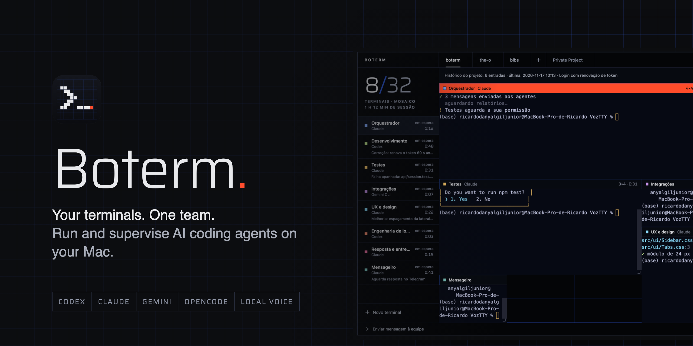
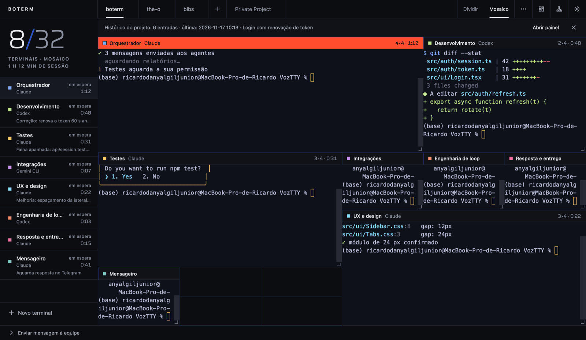
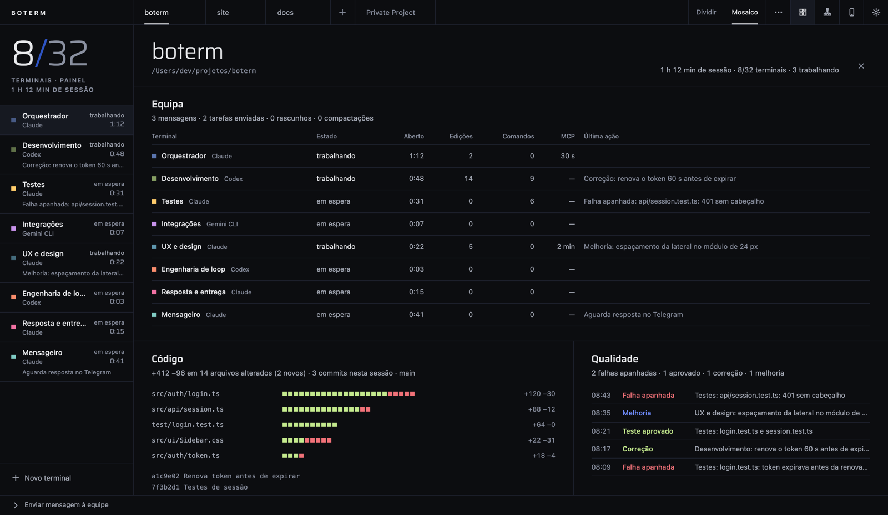
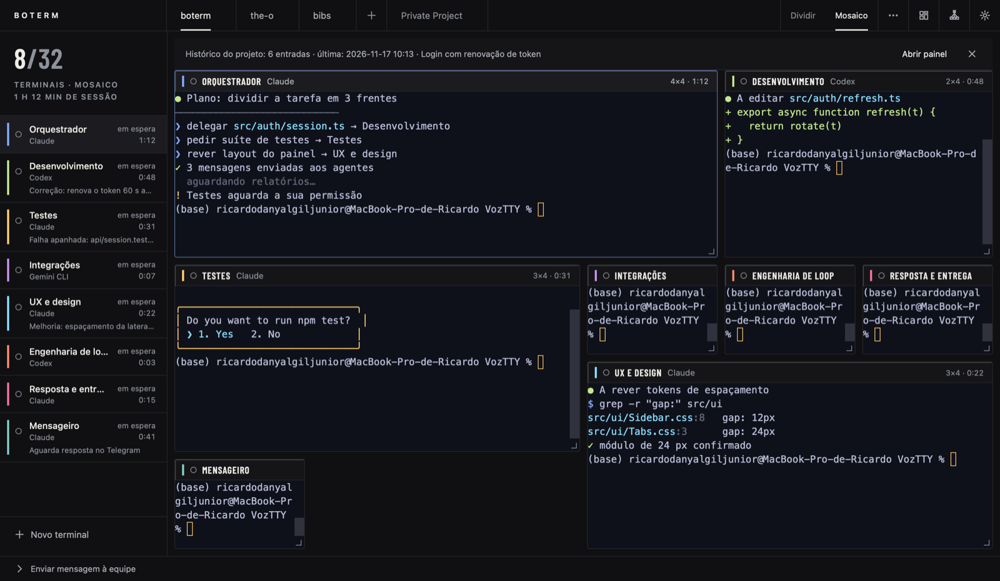
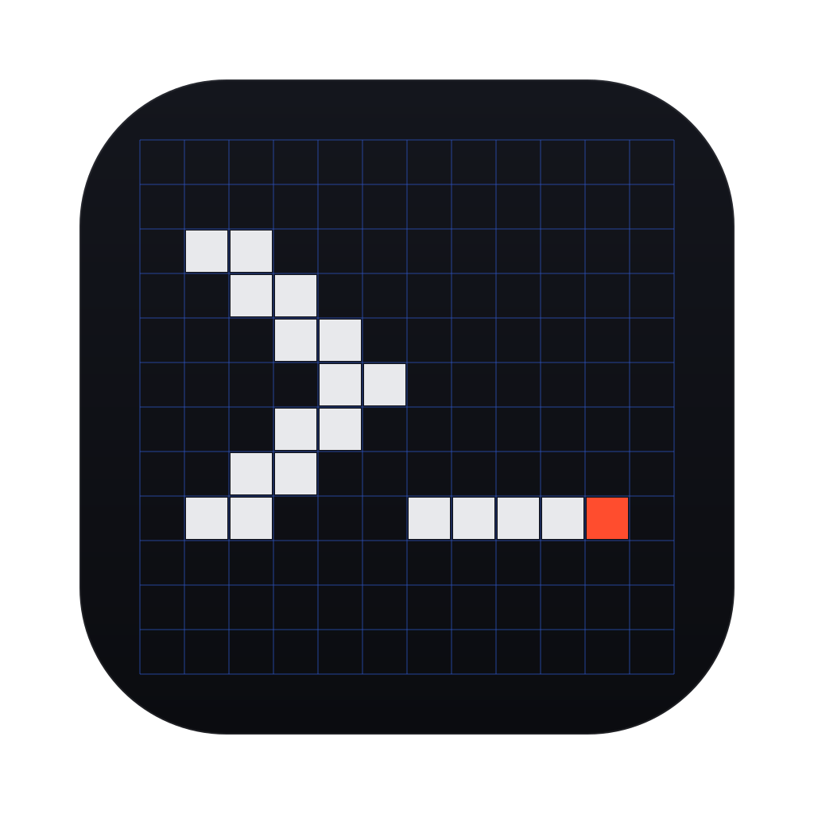

<p align="center">
  
</p>

<p align="center">
  <a href="https://github.com/ricdanyalgil/Boterm/releases/tag/v0.4.1"></a>
  
  
  <a href="LICENSE"></a>
</p>

<p align="center">
  <a href="#download">Download</a> ·
  <a href="#o-que-ele-faz">Funcionalidades</a> ·
  <a href="#a-equipe-de-desenvolvimento">A equipe</a> ·
  <a href="#agentes-conversam-entre-si">CLI dos agentes</a> ·
  <a href="#compilar-a-partir-do-código">Compilar</a> ·
  <a href="README.md">English</a>
</p>

---

**Boterm é um terminal nativo para macOS feito para rodar uma equipe de agentes de IA.** Codex, Claude, Gemini e OpenCode ganham cada um um terminal real. Eles trocam mensagens por um socket local e MCP, e você acompanha todos numa só tela: quem está trabalhando, quem está esperando e quem precisa de você.

Quem manda é você. O Boterm nunca aperta Enter por você, nunca responde a um pedido de aprovação e só fala com você fora do app com permissões que você concedeu e pode revogar.

> O Boterm se chamava **VozTTY** até a 0.2.9. A extensão do VS Code mantém esse nome; o ditado por voz continua aqui.

<p align="center">
  
  <br /><sub>Modo mosaico. Cada terminal ocupa células inteiras da grade; arraste o canto para redimensionar e o título para mover.</sub>
</p>

## O que ele faz

<table>
<tr>
<td width="50%" valign="top">

### Projetos e terminais
Abas de projeto no topo, os terminais do projeto à esquerda e uma área que mostra um terminal, uma divisão ou um mosaico livre. Salve um arranjo como perfil de layout e reaplique pelo nome.

</td>
<td width="50%" valign="top">

### Supervisão num olhar
Cada linha mostra função, provedor, estado e tempo do agente. Um terminal que pede confirmação, escolha ou login ganha um aviso de atenção com o motivo (“Pede: …”). O Boterm não responde por você.

</td>
</tr>
<tr>
<td valign="top">

### Agentes que conversam
Agentes do mesmo projeto listam, leem, mandam mensagens e entregam rascunhos uns aos outros com a CLI `boterm` incluída. Codex e Claude também recebem ferramentas MCP por sessão. Outros projetos ficam isolados, verificados pela ancestralidade dos processos.

</td>
<td valign="top">

### Memória do projeto
`.boterm/HISTORY.md` guarda um resumo das sessões anteriores com menos de 8 KB, lido antes de planejar. `.boterm/ROLES.md` reúne as regras que a equipe aprendeu; elas entram nos prompts da próxima equipe. Agentes ociosos têm o contexto compactado.

</td>
</tr>
<tr>
<td valign="top">

### Painel
Tempo de sessão, estado dos agentes ao vivo, código alterado desde que o projeto abriu, testes que pegaram falhas, correções, tempo de MCP por servidor e o histórico do projeto. Clique num agente para abrir o terminal dele.

</td>
<td valign="top">

### Voz que nunca envia
Dite com o reconhecimento de fala da Apple, no próprio Mac (pt-BR, pt-PT, en-US). O texto chega ao prompt como rascunho editável. O Enter é seu.

</td>
</tr>
</table>

<p align="center">
  
  <br /><sub>Painel do projeto. Os números destas capturas são dados de exemplo do harness de testes nativo.</sub>
</p>

## A equipe de desenvolvimento

Um clique (⌘ na barra superior) abre dez funções, cada uma no seu terminal com o provedor que você escolher:

| Função | O que faz |
| :--- | :--- |
| **Orquestrador** | Planeja com o histórico do projeto, distribui a posse dos arquivos, mantém o `BOTERM_PLAN.md` e confere resultados reais |
| **Desenvolvimento** | Escreve o código |
| **Testes** | Escreve e roda testes, registra as falhas encontradas |
| **Cibersegurança** | Red team e blue team: prova IDOR, escalada de privilégio, injeção e XSS com testes locais em cada diff testado, revisa dependências e todo documento que sai do projeto; achados críticos e altos bloqueiam o ciclo |
| **Integrações** | APIs, serviços e sistemas externos |
| **UX e design** | Interface e interação |
| **Engenharia de loop** | Mantém o ciclo de desenvolvimento andando |
| **Resposta e entrega** | Fecha e entrega |
| **Qualidade** | Revisa cada ciclo concluído e mantém as regras aprendidas em `.boterm/ROLES.md` |
| **Mensageiro** | O único canal com você fora do Boterm: Telegram (token no Keychain), WhatsApp ou email |

O Mensageiro espera a sua resposta e registra permissões permanentes, listadas e revogáveis em Ajustes. Nenhuma outra função fala com você fora do app.

O Orquestrador conduz implementação → testes → Cibersegurança → integrações → UX → loop. Nada chega à Engenharia de loop sem o parecer de segurança, achados críticos e altos voltam ao Desenvolvimento com um teste que os reproduz, e nenhum README, changelog, relatório ou anexo sai sem revisão de segurança. A lista de verificação (código, dependências e segredos, documentos que saem) são as skills editáveis da função.

## Agentes conversam entre si

```sh
boterm list                              # colegas neste projeto
boterm read SESSION                      # a saída deles
boterm message SESSION 'Testes falhando' # uma mensagem, não teclas
boterm send SESSION 'rascunho'           # um rascunho editável no prompt deles
boterm event test-fail 'api/session.test.ts: 401'   # um fato para o painel
boterm history                           # o que as sessões anteriores fizeram
```

Uma mensagem nunca dispara um modelo sozinha, e `send` insere um rascunho sem Enter. Enviar entrada a um colega exige `--submit` explícito. A saída dos terminais é tratada como dado não confiável. O guia completo está em [docs/AGENT_GUIDE.md](docs/AGENT_GUIDE.md).

## Dois visuais

<p align="center">
  
  <br /><sub><b>Grelha construída</b> é o padrão: uma grade de construção azul e um só cabeçalho laranja no terminal ativo. <b>Set de rodagem</b> (acima) fica em Ajustes → Aparência.</sub>
</p>

O texto dos terminais segue sempre o tema do VS Code instalado, e as cores ANSI das CLIs são preservadas.

## Download

**Requer um Mac com Apple Silicon e macOS 26 ou posterior.**

| Pacote | Download | Instalação |
| :--- | :--- | :--- |
| **Boterm 0.4.1** | [boterm-0.4.1-darwin-arm64.zip](https://github.com/ricdanyalgil/Boterm/releases/download/v0.4.1/boterm-0.4.1-darwin-arm64.zip) | Extraia e mova o **Boterm.app** para Aplicativos |
| Extensão VS Code 0.1.3 | [voztty-0.1.3-darwin-arm64.vsix](https://github.com/ricdanyalgil/Boterm/releases/download/v0.4.1/voztty-0.1.3-darwin-arm64.vsix) | Extensões → … → Install from VSIX… |
| Checksums | [SHA256SUMS.txt](https://github.com/ricdanyalgil/Boterm/releases/download/v0.4.1/SHA256SUMS.txt) | `shasum -a 256 -c SHA256SUMS.txt` |

É uma prévia pública, assinada com Developer ID mas **ainda sem notarização da Apple**; o macOS pode pedir aprovação na primeira abertura. Codex, Claude, Gemini (Antigravity `agy`) e OpenCode são instalados e autenticados à parte; o Boterm usa os seus logins e nunca configura chaves de API.

## Compilar a partir do código

Ferramentas de desenvolvimento da Apple com o SDK do macOS 26, e Node.js 22+ para os testes.

```sh
git clone https://github.com/ricdanyalgil/Boterm.git
cd Boterm
npm test
./terminal/build.sh
open terminal/Boterm.app
```

Sem dependências npm de produção. AppKit, WKWebView, um PTY real do macOS e o xterm.js empacotado localmente; sem CDN e sem runtime Node no app. Os harnesses nativos e a geração do ícone estão em [terminal/README.md](terminal/README.md).

<details>
<summary><b>Ditado por voz e vocabulário pessoal</b></summary>

<br />

Clique em **Ditar** na faixa inferior ou use <kbd>Control</kbd> + <kbd>Option</kbd> + <kbd>V</kbd>, fale e depois **Parar e inserir**. <kbd>Esc</kbd> cancela. O texto chega depois que você para; não há transcrição palavra a palavra. O reconhecimento roda no Mac pelo SpeechAnalyzer da Apple, sem nuvem do Boterm e sem chave de API de transcrição.

O Boterm corrige a grafia de nomes de assistentes e projetos depois da transcrição (“Cloud Code” → “Claude Code”). Edite a lista em **Boterm → Edit Vocabulary…** (⌘,). Um nome preferido por linha, alternativas depois do `=`:

```text
Claude Code = Cloud Code
MeuProjeto = Meu Projeto | Mel Projeto
```

É correção de texto, não treino acústico. Até 100 entradas, 32 KB, UTF-8. Um arquivo vazio desativa as correções; apague-o para voltar ao padrão.

A extensão do VS Code traz o mesmo ditado aos terminais integrados: instale o VSIX e clique no microfone da barra do terminal. Defina `voz.language` como `pt-BR`, `pt-PT` ou `en-US`.

</details>

<details>
<summary><b>Privacidade e limites</b></summary>

<br />

- Tudo roda localmente. Os sockets dos agentes ficam restritos ao seu usuário do macOS e às sessões do mesmo projeto; isto não é um sandbox do sistema contra programas rodando como você.
- As mensagens da equipe ficam em memória (últimas 200 por janela). O histórico do projeto e as regras aprendidas são arquivos de texto na pasta `.boterm/` do projeto. O histórico dos terminais só é gravado quando você escolhe Salvar histórico.
- “Trabalhando” quer dizer saída recente no terminal, não prova de que um modelo está gerando. A detecção de atenção cobre os pedidos comuns, não todos.
- Fechar o app encerra as shells; as sessões não sobrevivem a um reinício.
- Ainda sem teste de ponta a ponta: Telegram com um bot real, um ciclo completo da equipe com modelos reais e o microfone físico nesta versão.
- Macs Intel, Windows, Linux e o VS Code no navegador não são suportados.

</details>

## Contribuir

Relatos de bugs, correções de documentação, retorno sobre acessibilidade e pull requests são bem-vindos. Uma pequena correção de documentação ou um bug reproduzível é um ótimo primeiro passo.

[Guia de contribuição](CONTRIBUTING.md) · [Relatar um bug](https://github.com/ricdanyalgil/Boterm/issues/new/choose) · [Discussões](https://github.com/ricdanyalgil/Boterm/discussions) · [Changelog](CHANGELOG.md)

Use exemplos sintéticos, nunca gravações, tokens ou transcrições privadas.

## Licença

[MIT](LICENSE). Copyright © 2026 Ricardo Danyalgil Junior. Os componentes de terceiros incluídos mantêm as próprias [licenças](terminal/web/vendor/README.md).

<p align="center"><br /></p>
